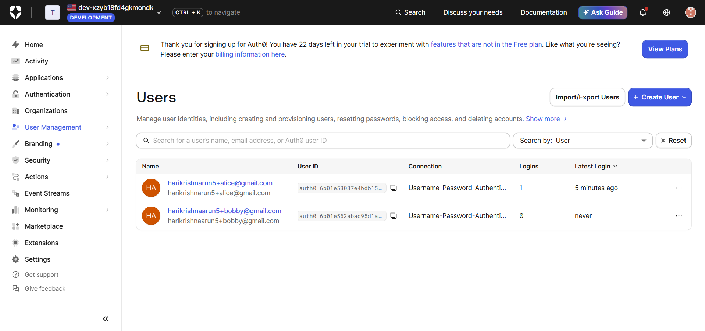
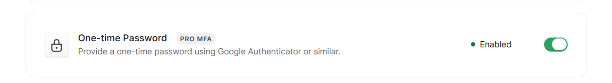
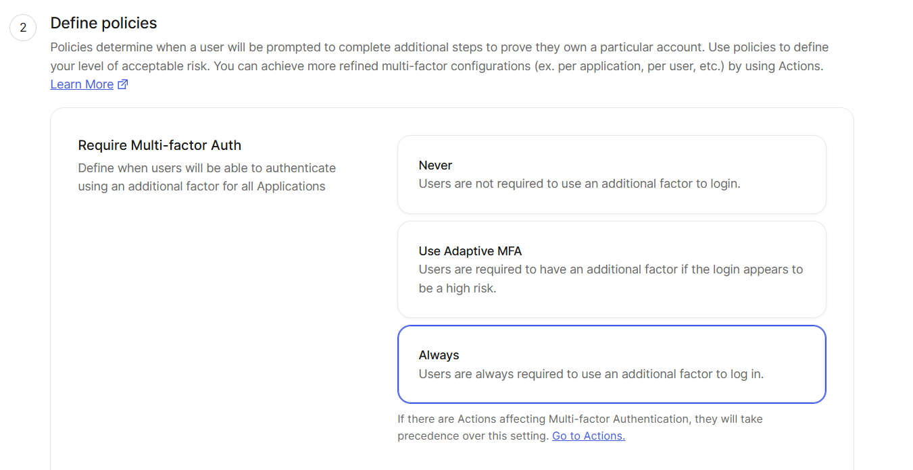
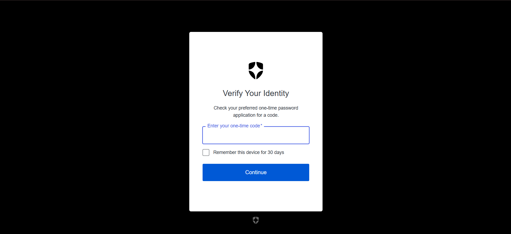
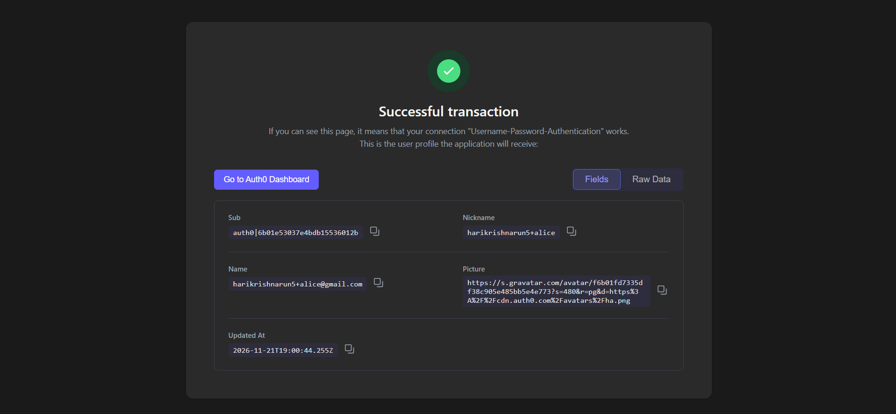

# Lab 1: Users and Multi-Factor Authentication (Auth0)

## Objective
Create test identities in a cloud identity provider and require multi-factor authentication (MFA), then verify the login flow end to end.

## Environment
- Platform: Auth0 (an Okta company), free developer tenant
- Tenant: dev-xzyb18fd4gkmondk (Development)
- Database connection: Username-Password-Authentication
- MFA factor: One-Time Password (authenticator app)

## Steps
1. Created an Auth0 tenant under the free developer plan.
2. Created two test users, alice and bob, in the Username-Password-Authentication database. Used plus-addressed emails so all mail reaches one inbox.
3. Under Security > Multi-factor Auth, enabled One-Time Password as an MFA factor.
4. Under Define policies, set "Require Multi-factor Auth" to Always, so every login needs a second factor.
5. Used Try connection on the database connection to log in as alice.
6. Enrolled an authenticator app by scanning the QR code, then passed the 6-digit code challenge.

## Screenshots

### 1. Test users

### 2. One-Time Password enabled

### 3. MFA policy set to Always

### 4. Login asking for the code

### 5. Successful login after MFA

## Observations
- With the policy on Always, a correct password alone is not enough to log in, which blocks attacks that rely on stolen passwords.
- Adaptive MFA (risk-based) is the alternative to Always. It only asks for the second factor when a login looks risky, such as a new device or location. It needs a paid plan, so it is not used here.
- Auth0's free plan has no Groups feature. Roles do the grouping job, and role-based access control is covered in Lab 2.

## Concepts demonstrated
- **Authentication:** proving who a user is, using two factors (password and one-time code).
- **Multi-factor authentication:** layering factors so one stolen credential is not enough.
- **Identity provider:** Auth0 acts as the system that verifies identities for applications.
- **Zero trust (verify explicitly):** every sign-in is checked, regardless of network or location.

## Relevance to Microsoft Entra
The same ideas map directly to Microsoft Entra ID: users and groups, MFA, and Conditional Access policies. Always-on MFA here corresponds to a Conditional Access policy that requires MFA for all sign-ins, and adaptive MFA corresponds to risk-based Conditional Access with Entra ID Protection.

## Next
Lab 2: role-based access control (RBAC).
