# Lab 2: Role-Based Access Control with Auth0 and Flask

A Flask app that signs users in through Auth0 and shows their email and API permissions. Permissions come from roles assigned in Auth0 and arrive in the access token.

## What it does
- Login and logout through Auth0 using Authlib
- MFA on login
- Shows the signed-in user's email
- Shows the permissions from the access token's `permissions` claim

## Roles and permissions
| User  | Role   | Permissions shown |
|-------|--------|-------------------|
| alice | viewer | read:orders |
| bobby | editor | read:orders, write:orders |
| carol | admin  | read:orders, write:orders, delete:orders, read:reports |

## How it works
1. `/login` sends the user to Auth0 with an `audience`, so Auth0 issues an access token for my API.
2. With RBAC enabled and "Add Permissions in the Access Token" on, Auth0 adds the user's role permissions to that token.
3. `/callback` exchanges the code for tokens and stores them in the Flask session.
4. `/` decodes the access token and displays the permissions.
5. `/logout` clears the session and calls Auth0's `/v2/logout`.

## Setup
1. In Auth0, create a Regular Web Application and an API. Enable RBAC and add permissions to the access token.
2. Allowed Callback URLs: `http://127.0.0.1:5000/callback`
3. Allowed Logout URLs: `http://127.0.0.1:5000`
4. Create a `.env` file (not committed). See `.env.example`:
```
AUTH0_DOMAIN=
AUTH0_CLIENT_ID=
AUTH0_CLIENT_SECRET=
AUTH0_AUDIENCE=
APP_SECRET_KEY=
```
5. Install and run:
```
pip install -r requirements.txt
python app.py
```
6. Open `http://127.0.0.1:5000`

## Screenshots

### Login flow
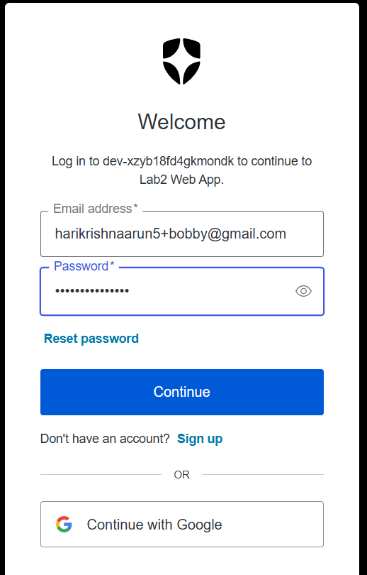
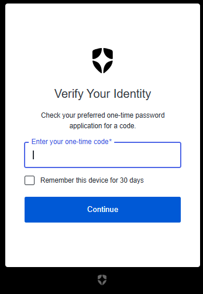
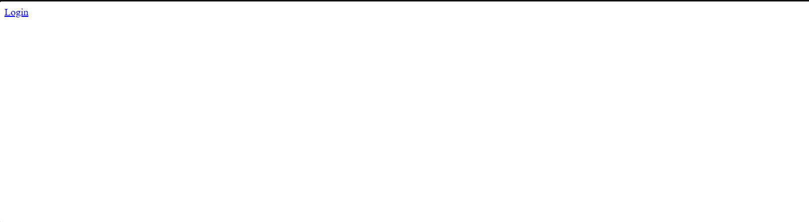

### Result per user
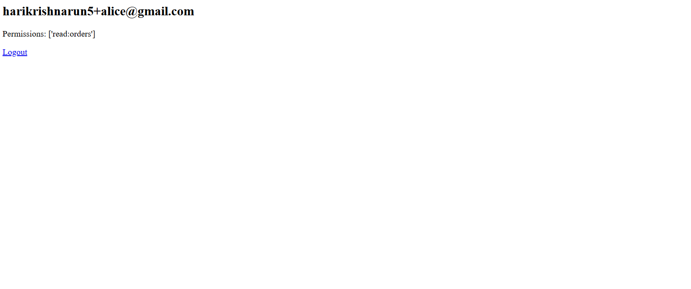
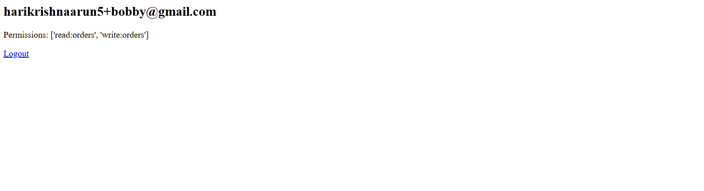
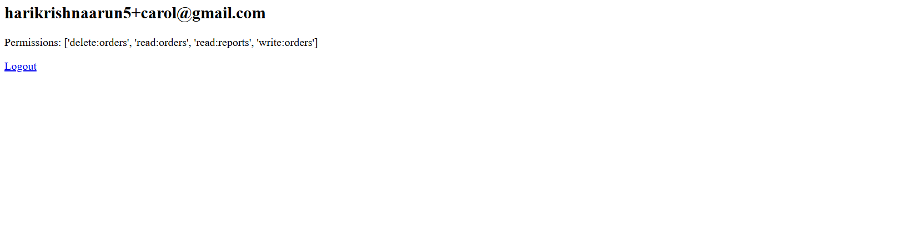

### Auth0 configuration
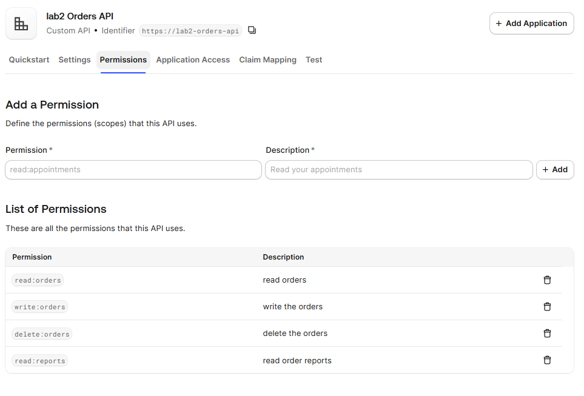
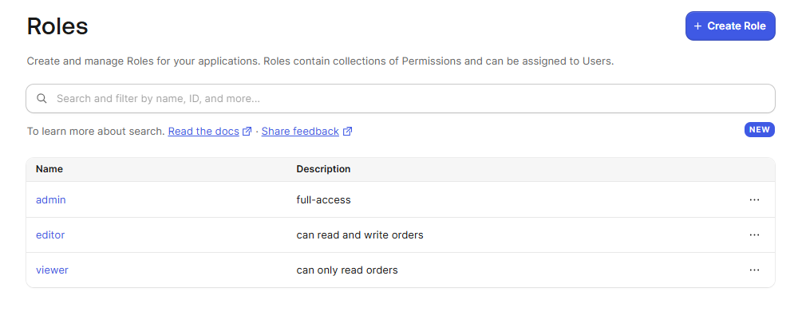
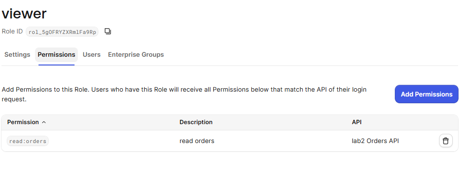
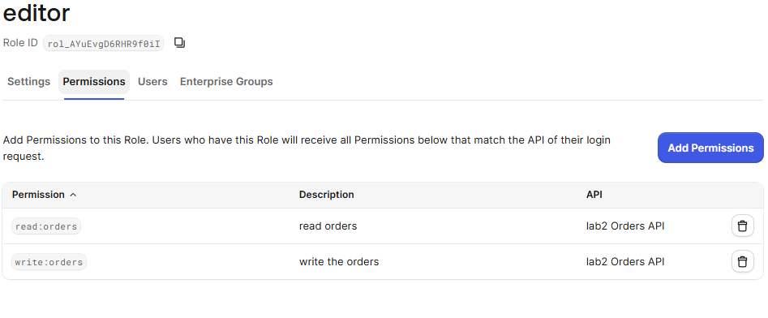
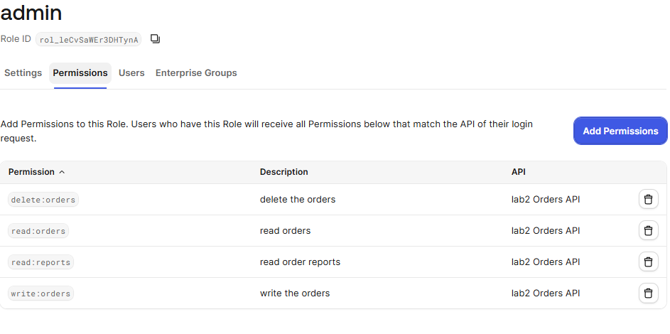
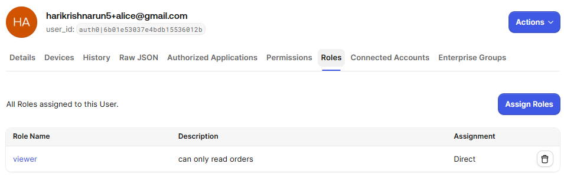
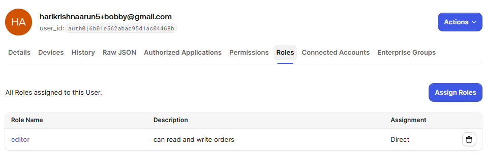
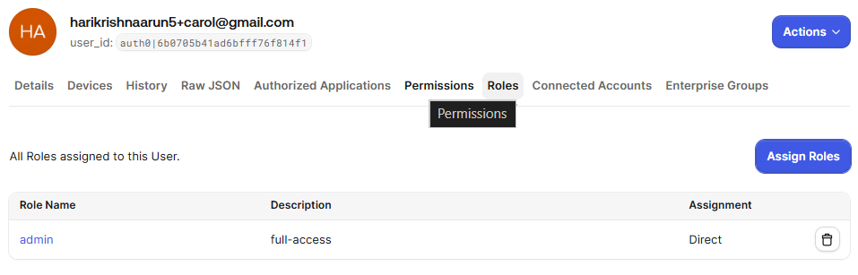
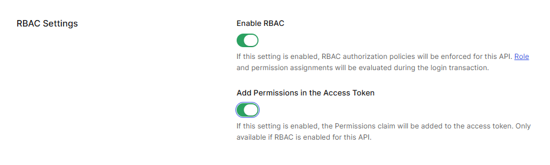
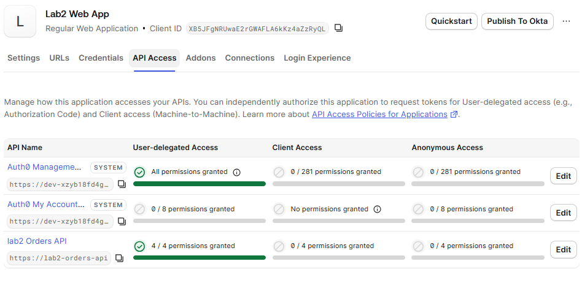
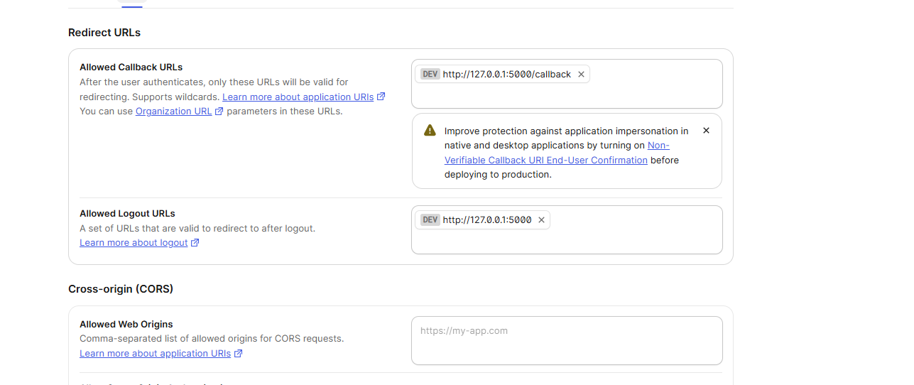

## Troubleshooting I went through
- **Login returned a 500 error:** the `.env` values were missing, so `os.getenv` returned `None` and building the metadata URL failed. Filling in all five values fixed it.
- **Callback and logout URL mismatch:** I mixed `localhost` and `127.0.0.1`, so the session cookie did not carry across hosts and the callback failed. I used `127.0.0.1` everywhere, in both Auth0's allowed URLs and the code.
- **Logout parameters:** I built the query string with `urlencode()` instead of joining strings by hand.
- **Debugging:** I temporarily printed the host, session keys and redirect URI to trace the failure, then removed those lines.

## Security notes
- The access token is decoded without signature verification, for display only. A real API must verify the signature, issuer and audience.
- `.env` is gitignored. Rotate any secret that has been shared.