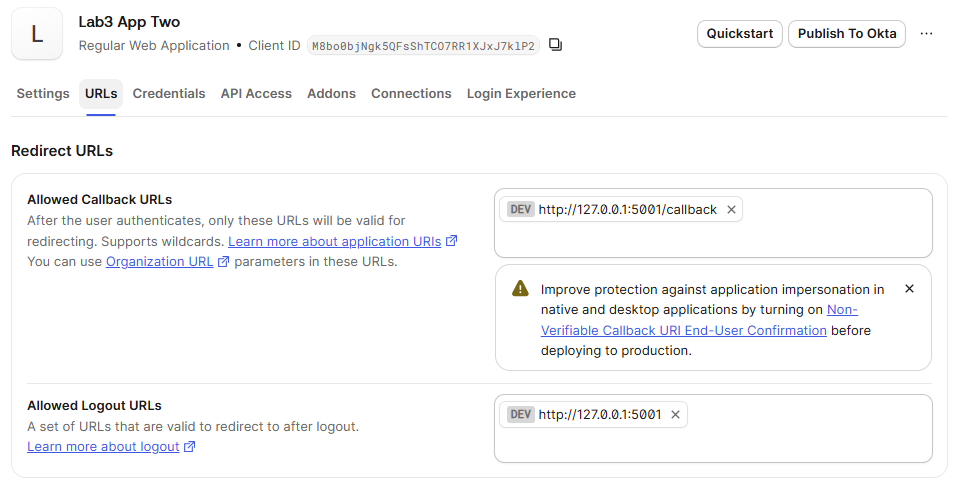
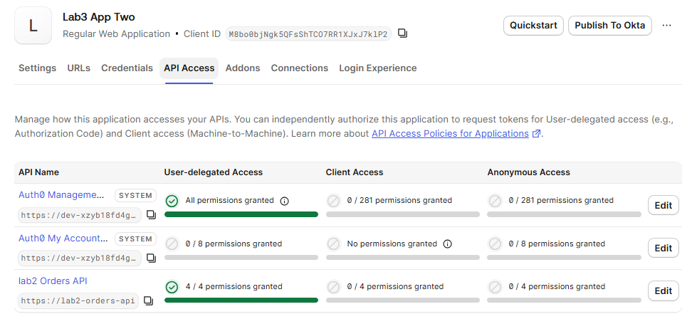
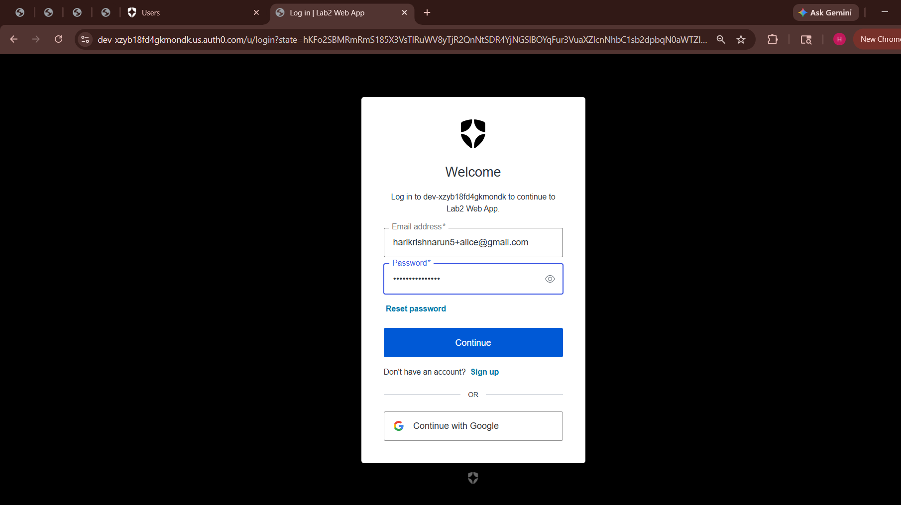
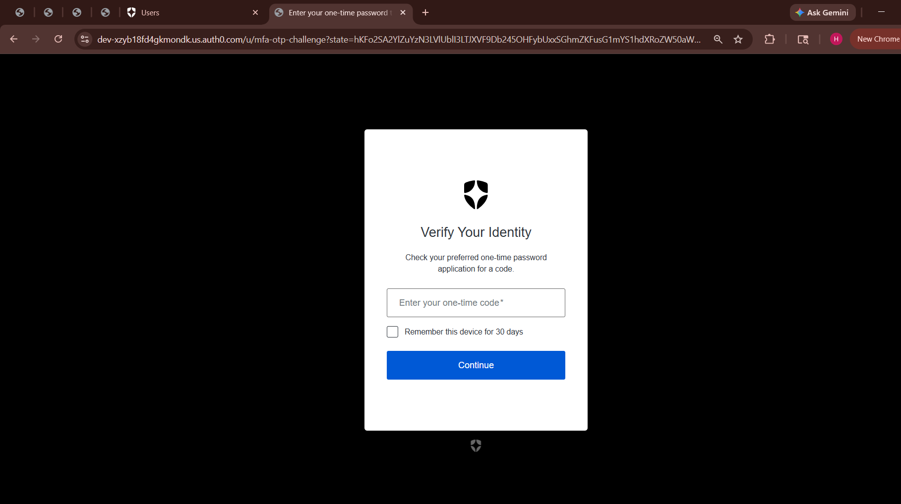
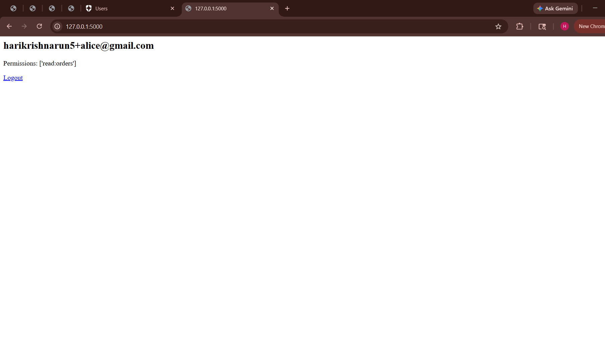
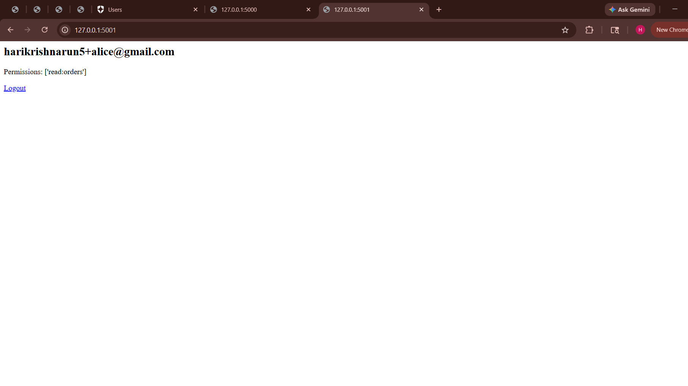
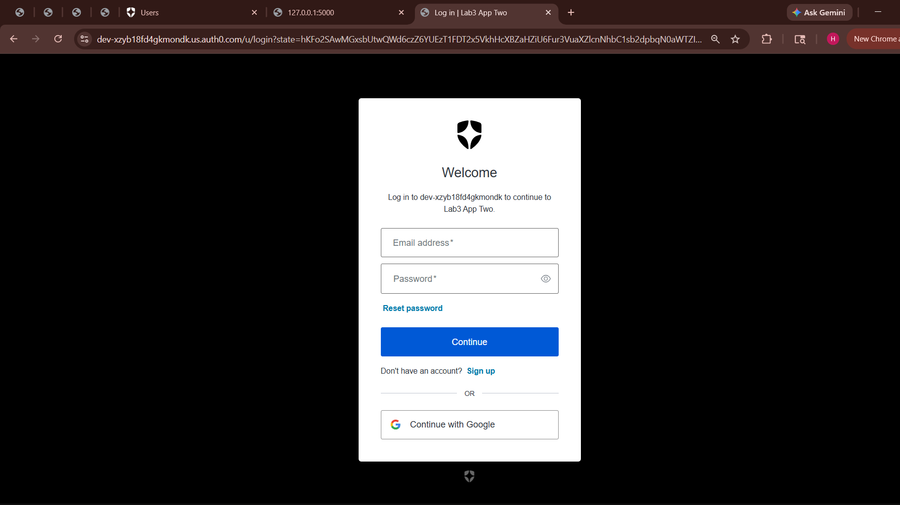

# Lab 3: Single Sign-On (SSO) with Auth0 and Two Flask Apps

Two separate Flask applications share one Auth0 login. After signing in to App 1, the user opens App 2 and is logged in without entering a password or MFA code again.

## Objective
Show that one identity provider session can authenticate a user across multiple independent applications, and observe how logout affects that shared session.

## Architecture
| Component | Details |
|---|---|
| Identity provider | Auth0 tenant, Universal Login, MFA policy set to Always |
| App 1 | Flask, `http://127.0.0.1:5000`, Auth0 app "Lab2 Web App" |
| App 2 | Flask, `http://127.0.0.1:5001`, Auth0 app "Lab3 App Two" |
| Protocol | OpenID Connect, Authorization Code flow (Authlib) |
| API audience | `https://lab2-orders-api` (RBAC permissions from Lab 2) |
| Test user | alice (viewer role) |

## How SSO works here
1. The user logs in to App 1. Auth0 checks the password and MFA, then creates a session on the Auth0 domain.
2. The user opens App 2 and clicks Login. App 2 redirects to the same Auth0 tenant.
3. Auth0 finds its existing session and returns straight to App 2 with tokens. No password, no MFA prompt.
4. Each app keeps its own local Flask session. The Auth0 session is the shared piece.

## Folder structure
```
lab-3/
├── app1/            # port 5000
│   ├── app.py
│   ├── requirements.txt
│   └── .env.example
├── app2/            # port 5001
│   ├── app.py
│   ├── requirements.txt
│   └── .env.example
├── screenshots/
└── README.md
```

## Setup
1. In Auth0, create a second Regular Web Application for App 2:
   - Allowed Callback URL: `http://127.0.0.1:5001/callback`
   - Allowed Logout URL: `http://127.0.0.1:5001`
   - API Access: user-delegated access to the Lab 2 Orders API
2. In each app folder, create a `.env` from `.env.example` with that app's own Client ID and Client Secret. Both apps use the same domain and audience.
3. Install and run each app in its own terminal:
```
python -m venv .venv
.venv\Scripts\activate
pip install -r app1\requirements.txt
python app1\app.py
python app2\app.py
```
4. Use one normal browser window and `127.0.0.1` for both apps.

## Test cases
| # | Test | Expected | Result |
|---|---|---|---|
| 1 | Log in to App 1 as alice | Password page, then MFA | Pass |
| 2 | Open App 2 in the same browser and click Login | Logged in with no password or MFA | Pass |
| 3 | Log out of App 2, then click Login on App 2 | Auth0 asks for email and password again | Pass |

## Screenshots

### App 2 configuration



### App 1 login




### SSO into App 2


### Logout


## Observations
- **MFA happened once.** The Auth0 session from App 1 covered App 2, so the user was not prompted again.
- **Logout is not global by default.** Logging out of App 2 ended the Auth0 session, but App 1 still showed alice, because App 1 keeps its own local session cookie. Fixing that needs single logout (for example back-channel logout), which this lab does not implement.
- **Separate cookie names matter.** Browsers share cookies across ports on the same host, so each app sets its own `SESSION_COOKIE_NAME` (`app1_session`, `app2_session`). Without this, the apps would overwrite each other's session.

## Cookie settings used
- `SESSION_COOKIE_SAMESITE = "Lax"`: the session cookie is sent when Auth0 redirects back to the app, so login works, but not on hidden cross-site requests, which blocks CSRF.
- `SESSION_COOKIE_HTTPONLY = True`: page scripts cannot read the cookie, which protects the session from XSS.

## Troubleshooting
- **500 error on login:** `ValueError` saying SameSite must be Strict, Lax or None. I had put the cookie name into the SameSite setting by mistake. I fixed it by adding `SESSION_COOKIE_NAME` as its own line and setting SameSite back to `"Lax"`.
- **Login jumped straight to an old MFA prompt:** an earlier login was left half-finished, and Auth0 resumed it. Visiting `/logout` cleared the Auth0 session and allowed a fresh start.
- **Browser choice:** the VS Code built-in browser was unreliable for the shared Auth0 cookie, so all tests used one Chrome window.

## Security notes
- The access token is decoded without signature verification, for display only. A real API must verify the signature, issuer and audience.
- `.env` files are gitignored. Each app has its own client secret.