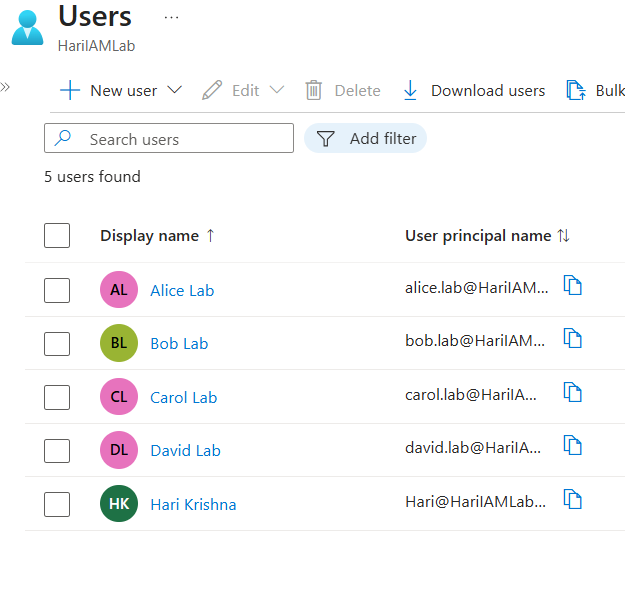
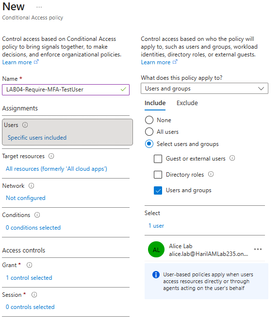
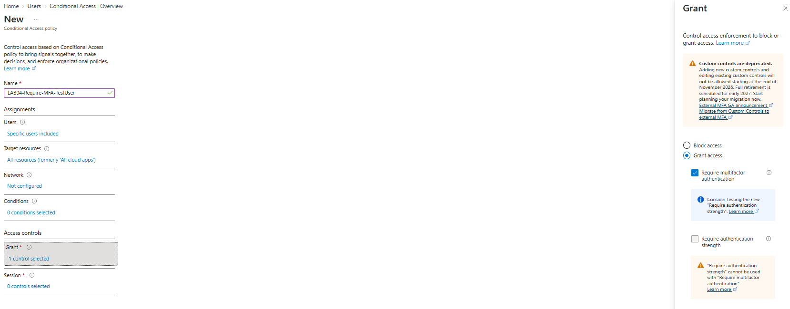
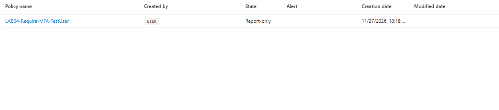
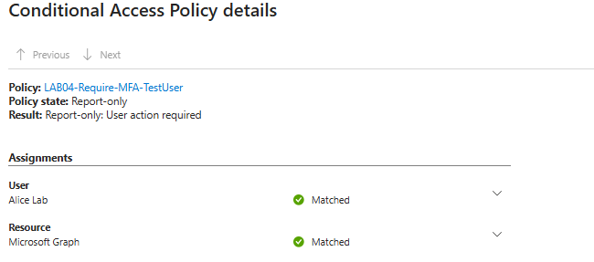

# Lab 4: Conditional Access and MFA with Microsoft Entra ID

Configured a Microsoft Entra Conditional Access policy requiring multifactor authentication (MFA) for a selected test user. Evaluated the policy in **Report-only** mode without enforcing MFA.

## Objective

Understand how Conditional Access evaluates sign-ins, how an MFA grant control is configured, and how report-only results can be verified before enforcement.

## Architecture

| Component | Details |
|---|---|
| Identity provider | Microsoft Entra ID |
| Tenant | `HariIAMLab235.onmicrosoft.com` |
| License | Microsoft Entra ID P2 trial |
| Test user | Alice Lab |
| Additional test users | Bob Lab, Carol Lab, David Lab |
| Policy | `LAB04-Require-MFA-TestUser` |
| Assigned user | Alice Lab only |
| Target resources | All resources |
| Conditions | Not configured |
| Grant control | Require multifactor authentication |
| Policy state | Report-only |
| Sign-in portal | `https://myapps.microsoft.com` |

## How Conditional Access Works Here

1. Alice signs in to Microsoft My Apps.
2. Microsoft Entra evaluates her sign-in against Conditional Access policies.
3. The lab policy matches Alice and the Microsoft Graph resource.
4. The grant control requires MFA.
5. Because the policy is in **Report-only** mode, the requirement is evaluated but **not enforced**.
6. The sign-in logs show **Report-only: User action required**.

This result indicates additional user action would be needed to satisfy the policy if it were enforced. It does **not** mean an MFA challenge occurred.

## Folder Structure

```text
lab-4/
├── screenshots/
│   ├── 01-entra-test-users.png
│   ├── 02-conditional-access-policy.png
│   ├── 03-mfa-requirement.png
│   ├── 04-policy-report-only.png
│   └── 05-alice-signin-report-only.png
└── README.md
```

## Setup

1. Created four Microsoft Entra member accounts: Alice, Bob, Carol, and David.
2. Opened **Microsoft Entra admin center → Protection → Conditional Access → Policies**.
3. Created the policy `LAB04-Require-MFA-TestUser`.
4. Assigned **Alice Lab** under Users and selected **All resources**.
5. Selected **Grant access → Require multifactor authentication**.
6. Left Conditions and Session controls unconfigured.
7. Set the policy state to **Report-only**.

## Test Cases

| # | Test | Expected | Observed result |
|---|---|---|---|
| 1 | Create test accounts | Four test users exist | Pass |
| 2 | Assign policy | Alice is targeted | Pass |
| 3 | Configure grant control | Require MFA selected | Pass |
| 4 | Set Report-only state | Policy does not enforce MFA | Pass |
| 5 | Sign in as Alice | Sign-in possible without policy-enforced MFA | Pass |
| 6 | Inspect sign-in logs | Report-only evaluation identifies required user action | Pass |

### Sign-in Test

Opened `https://myapps.microsoft.com` in Chrome Incognito and signed in as Alice. Alice changed her initial password during the first sign-in. Microsoft My Apps opened without an MFA prompt from the report-only policy.

### Verification

In **Microsoft Entra admin center → Monitoring & health → Sign-in logs → User sign-ins (interactive)**, selected Alice's sign-in and inspected the **Report-only** tab.

| Field | Observed value |
|---|---|
| Policy | `LAB04-Require-MFA-TestUser` |
| State | Report-only |
| Result | **Report-only: User action required** |
| User assignment | Alice Lab — Matched |
| Resource assignment | Microsoft Graph — Matched |
| Actual MFA enforcement | Not performed |

## Screenshots

### Test Users



### Conditional Access Policy



### MFA Grant Control



### Report-only State



### Alice Sign-in Evaluation



## Observations

- **Report-only is evaluation, not enforcement.** Alice was not prompted for MFA by this policy.
- **The policy matched.** The Report-only tab showed Alice and Microsoft Graph as matched assignments.
- **User action required** indicates that additional authentication would be needed if the policy were enforced.
- **Conditional Access MFA differs from legacy per-user MFA.** Legacy per-user MFA was not enabled for Alice.
- The general sign-in Conditional Access status and the separate Report-only evaluation describe different things.

## Troubleshooting

- **No MFA prompt:** Expected because the policy was in Report-only mode.
- **Conditional Access listed as Not applied:** Inspected the separate Report-only tab for the simulated evaluation.
- **First-sign-in password change:** Completed Alice's initial password update before verifying the sign-in logs.

## Security Notes

- Security Defaults remained enabled during this lab.
- The Conditional Access policy was **not** switched to On.
- Actual MFA enforcement was **not** tested.
- Review tenant settings and administrator recovery arrangements before any future enforcement test to avoid lockout.
- Do not commit passwords, tokens, recovery codes, or other secrets to GitHub.
- Review screenshots for sensitive information before publishing.

## Conclusion

Configured a Microsoft Entra Conditional Access policy targeting Alice and requiring MFA. Verified through sign-in logs that its Report-only evaluation returned **Report-only: User action required**. This demonstrates simulated policy evaluation, **not** actual MFA enforcement.